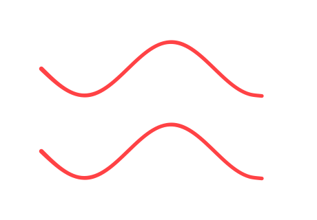
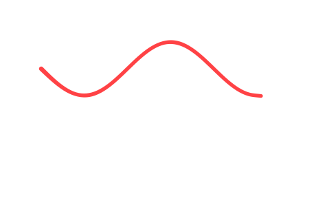
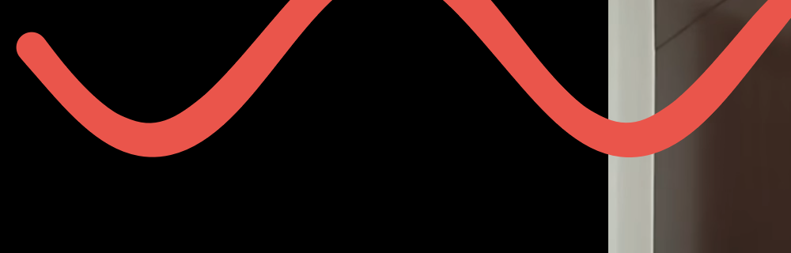

# First build — run record

This page is the test run for the first build of Annotated: the hot-key overlay, freehand drawing, undo/redo, the object eraser, and screen capture.

Run on macOS 26.6.2 (Darwin 25.6.0), Swift 6.3.3, on a two-display setup (2560×1440 @2x and 1512×982 @2x).

## Test cases

| # | Action/input | Expected | Source | Result (measured) | Evidence |
| --- | --- | --- | --- | --- | --- |
| C1 | Commit two freehand strokes to a `Board` | Board holds 2 strokes, both rendered | `Board.commit` (`Sources/Annotated/Board.swift:42`) | 0 → 2 strokes | Committing two 41-point waves left the board at 2 strokes and rendered both.  |
| C2 | `Board.undo()` | Last stroke removed | `Board.undo` (`Sources/Annotated/Board.swift:89`) | 2 → 1 strokes | One undo left a single stroke on the canvas.  |
| C3 | `Board.redo()` | Stroke restored | `Board.redo` (`Sources/Annotated/Board.swift:95`) | 1 → 2 strokes | Redo put the stroke back, count 1 → 2. [harness-output.txt](../artifacts/first-build/harness-output.txt) |
| C4 | One eraser drag crossing both strokes | Both gone, canvas empty | `Board.erase` (`Sources/Annotated/Board.swift:78`) | 2 → 0 strokes, 0 red pixels sampled | Two `erase` calls in one drag removed both strokes and the rendered canvas sampled 0 reddish pixels.  |
| C5 | `undo` after that eraser drag | One undo restores both | `Board.erase` checkpointing (`Sources/Annotated/Board.swift:79`) | 0 → 2 strokes | A single undo after the drag restored both strokes at once.  |
| C6 | Eraser drag touching nothing, then `undo` | The drag takes no undo slot | `Board.erase` guard (`Sources/Annotated/Board.swift:79`) | 1 → 1 → 0 strokes | Erasing at (400,300) with ink only near (60,100) changed nothing, and the next undo removed the drawn stroke, so the miss consumed no undo step. [harness-output.txt](../artifacts/first-build/harness-output.txt) |
| C7 | Hit test at 9.75 px and 10.75 px from a 2 pt stroke | Inside hits, outside misses | `Board.hit` (`Sources/Annotated/Board.swift:102`) | 9.75 px → index 0; 10.75 px → nil | Probing either side of the 10.25 px tolerance returned the stroke index inside and nil outside. [harness-output.txt](../artifacts/first-build/harness-output.txt) |
| C8 | Register `esc`, `⌘Z`, `⇧⌘Z`, `⇧⌘C` as global hot keys | All four register | `OverlayController.registerOverlayHotkeys` (`Sources/Annotated/Overlay.swift:179`) | 4 of 4 returned a token | Registering each of the overlay's four shortcuts through `HotkeyCenter` returned a token. [harness-output.txt](../artifacts/first-build/harness-output.txt) |
| C9 | Unregister them, then register `esc` again | The combination is free again | `HotkeyCenter.unregister` (`Sources/Annotated/Hotkeys.swift:48`) | re-registration returned a token | After unregistering all four, `esc` registered again, so dismissing the overlay hands its shortcuts back. [harness-output.txt](../artifacts/first-build/harness-output.txt) |
| C10 | Seven stroke shapes through `strokeOutline` vs npm perfect-freehand 1.2.x | Identical outlines | `Sources/Annotated/Freehand.swift`, npm `perfect-freehand` | 7/7 cases, max deviation 0.0000000000 px | Dot, 2-point, 3-point, curvy-with-reversal, zigzag, slow-drag and duplicate-point inputs gave identical point counts and 0 px maximum deviation. [reference-compare-output.txt](../artifacts/first-build/reference-compare-output.txt) |
| C11 | `CanvasHostingView.hitTest` at an arbitrary point | Returns the canvas, not nil | `CanvasHostingView.hitTest` (`Sources/Annotated/Overlay.swift:38`) | returned the `CanvasHostingView` | Hit-testing the transparent canvas at (500,500) returned the view instead of nil. [harness-output.txt](../artifacts/first-build/harness-output.txt) |
| C12 | `mouseDown` + 30 × `mouseDragged` + `mouseUp` on the real view | One stroke committed, live stroke cleared | `CanvasHostingView.mouseDown` (`Sources/Annotated/Overlay.swift:59`) | 31 live points during the drag, 1 stroke after, 0 live after | Driving real `NSEvent`s through the view tracked 31 live points and committed exactly one stroke on mouse up. [harness-output.txt](../artifacts/first-build/harness-output.txt) |
| C13 | Click 100 px below the top of the screen | Lands at canvas y = 100 | `CanvasHostingView.location(of:)` (`Sources/Annotated/Overlay.swift:54`) | canvas y = 100.0 | A window-coordinate click 100 px below the screen top landed at canvas y=100.0, so the bottom-left to top-left flip is exact. [harness-output.txt](../artifacts/first-build/harness-output.txt) |
| C14 | Option-drag across a stroke | Stroke erased, nothing committed | `Board.beginInput` (`Sources/Annotated/Board.swift:49`) | 1 → 0 strokes | An option-held drag over the stroke erased it and added nothing. [harness-output.txt](../artifacts/first-build/harness-output.txt) |
| C15 | `acceptsFirstMouse` on the canvas | true | `CanvasHostingView.acceptsFirstMouse` (`Sources/Annotated/Overlay.swift:48`) | true | The canvas reports that it takes the first click rather than spending it on activation. [harness-output.txt](../artifacts/first-build/harness-output.txt) |
| C16 | Launch `Annotated.app` | Runs with no Dock icon, not a visible process | `setActivationPolicy(.accessory)` (`Sources/Annotated/main.swift:52`), `LSUIElement` | pid running, absent from the visible-process list | Launching the bundle left a running process that System Events did not list among visible processes. [live-run-output.txt](../artifacts/first-build/live-run-output.txt) |
| C17 | Show the overlay on two displays | One canvas and one HUD per display | `OverlayController.show` (`Sources/Annotated/Overlay.swift:155`) | 4 windows: 2560×1440 and 1512×982, each twice | `CGWindowListCopyWindowInfo` reported four on-screen Annotated windows matching both display frames. [overlay-windows-output.txt](../artifacts/first-build/overlay-windows-output.txt) |
| C18 | Capture with ink on screen | PNG containing the drawing over the desktop, no HUD | `Capture.grab` (`Sources/Annotated/Capture.swift:26`) | 5120×2880 PNG, stroke present, no HUD border or pill | Capturing with a stroke on the canvas produced a PNG whose crop shows red ink over live desktop content and whose top strip shows neither the HUD pill nor its border.  |
| C19 | `copyToPasteboard` then `saveToDesktop` | Image on the pasteboard, PNG written | `Capture.copyToPasteboard` (`Sources/Annotated/Capture.swift:44`) | pasteboard `["public.tiff", "NeXT TIFF v4.0 pasteboard type"]`, 3887940-byte PNG | Clearing the pasteboard, capturing and copying left TIFF image types on it and wrote a 3.9 MB PNG. [capture-output.txt](../artifacts/first-build/capture-output.txt) |
| C20 | Start the app and read its log | Hot key registered | `AppDelegate` (`Sources/Annotated/main.swift:23`) | `annotated: hotkey registered` | Launching the bundle logged successful registration of `⌥⌘A`. [live-run-output.txt](../artifacts/first-build/live-run-output.txt) |
| C21 | Start a second copy while the first holds `⌥⌘A` | Second copy reports the shortcut taken | `HotkeyCenter.register` (`Sources/Annotated/Hotkeys.swift:35`) | Second copy also logged `hotkey registered` | A second copy logged successful registration instead of a conflict; see Findings. [live-run-output.txt](../artifacts/first-build/live-run-output.txt) |
| C22 | `open -a Annotated.app` twice | One process | LaunchServices | 1 process | Two `open` calls two seconds apart left a single Annotated process. [live-run-output.txt](../artifacts/first-build/live-run-output.txt) |
| C23 | End to end by hand: `⌥⌘A`, draw, `⌘Z`, `⌥`-drag to erase, `⇧⌘C`, `esc` | Every step works on a real desktop | the whole app | The user confirmed all of it working | The user drove the built app on their own machine and reported drawing, undo, the eraser, capture and dismiss all working. |

C1–C15 were driven by [harness.swift](../artifacts/first-build/harness.swift), which links the app's own sources and calls them directly. C10 compared [reference-compare.swift](../artifacts/first-build/reference-compare.swift) against outlines from [reference-generate.mjs](../artifacts/first-build/reference-generate.mjs) running npm `perfect-freehand`.

C23 was driven by the user, not by this agent. Posting synthetic mouse and key events needs Accessibility permission, which this environment does not grant, so the hot key and the pointer could not be exercised through the window server here. Every layer beneath them was driven directly.

## Gotchas

- `RegisterEventHotKey` needs no Accessibility permission, but posting synthetic key or mouse events does, so an agent cannot press the shortcut or draw a stroke for a test on a machine where the terminal lacks that grant. All four window-server bugs below were found from logs the user's own presses produced.
- `mouseMoved` is delivered to the key window whatever is under the cursor, so it is worthless as evidence that a window is hit-testable. Only `mouseDown` proves that.
- The Screen Recording grant follows the code signature. `build.sh` signs ad-hoc when `CODESIGN_IDENTITY` is unset, and every ad-hoc rebuild produces a new signature, so macOS re-prompts.
- The canvas window carries a background alpha of 1/255, which lands in the screenshot as a roughly 0.4% white wash over the whole image.
- Three cases failed on their first run because the case was wrong, not the code: two targeted coordinates that missed the stroke or asserted an undo backwards, and one reused a board that already held strokes. All were corrected against the code before this record.

## Findings from the run

- **The window server does not hit-test a fully transparent window.** With `backgroundColor = .clear` the canvas received `mouseMoved` (which goes to the key window regardless) but never `mouseDown`; clicks passed through to the app underneath, which then took focus and broke `esc` as well. A background alpha of 1/255 makes the window own its clicks and is invisible on screen. [focus-diagnosis-log.txt](../artifacts/first-build/focus-diagnosis-log.txt)
- **`NSPanel.isFloatingPanel` setter overwrites `level`.** Setting `level = .screenSaver` and then `isFloatingPanel = true` leaves the window at `.floating` (3), silently, which puts it behind a full-screen app's window. Measured `level=3` where 1000 was assigned.
- **`NSHostingView.hitTest` returns nil wherever the SwiftUI content is transparent.** This is separate from the window-server hit test and has to be fixed separately, by overriding `hitTest` on the hosting view. `.contentShape(Rectangle())` governs only SwiftUI's internal gesture routing and does not help.
- **A background `.accessory` app cannot hold key focus under macOS 14+ cooperative activation.** `NSApp.activate` reported success and the panel was key for five seconds, then focus returned to the front app and every window-level shortcut stopped working. The overlay's shortcuts are global Carbon hot keys for that reason, registered while it is up and released when it closes.
- **`RegisterEventHotKey` returns `noErr` for a combination another process already owns.** Two copies both registered `⌥⌘A` and both logged success (C21). The "could not register ⌥⌘A" alert only catches a registration the system itself rejects, never a cross-application conflict.
- **A window at `.screenSaver` level is included in a ScreenCaptureKit display capture.** `SCContentFilter` composites the canvas ink into the screenshot with no second drawing pass, and excluding the HUD window keeps it out (C18).
- **LaunchServices already prevents a second instance** of the bundle (C22), so the app needs no single-instance guard. Running the executable inside the bundle directly does bypass it.

## State left behind

Nothing persistent. The app writes no preferences and no files except the capture PNG on the Desktop; every PNG written during this run was deleted. No copy of Annotated was installed to `/Applications`, so `SMAppService.mainApp.register()` never ran and no Login Items entry was created.
