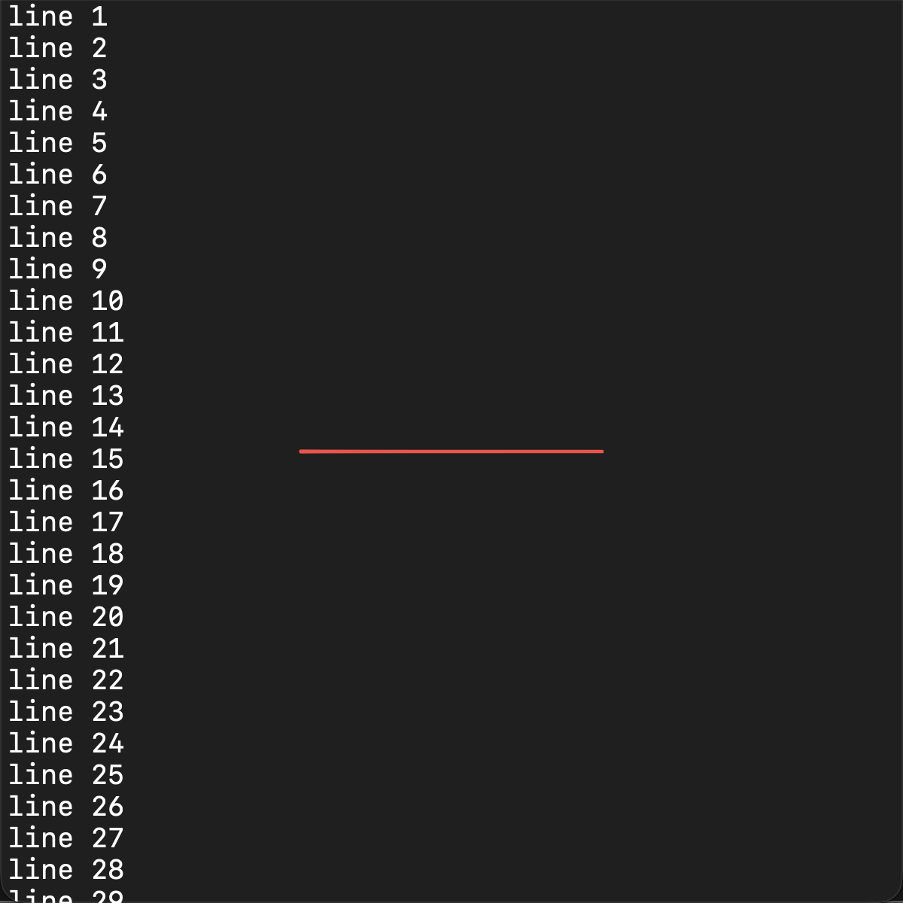
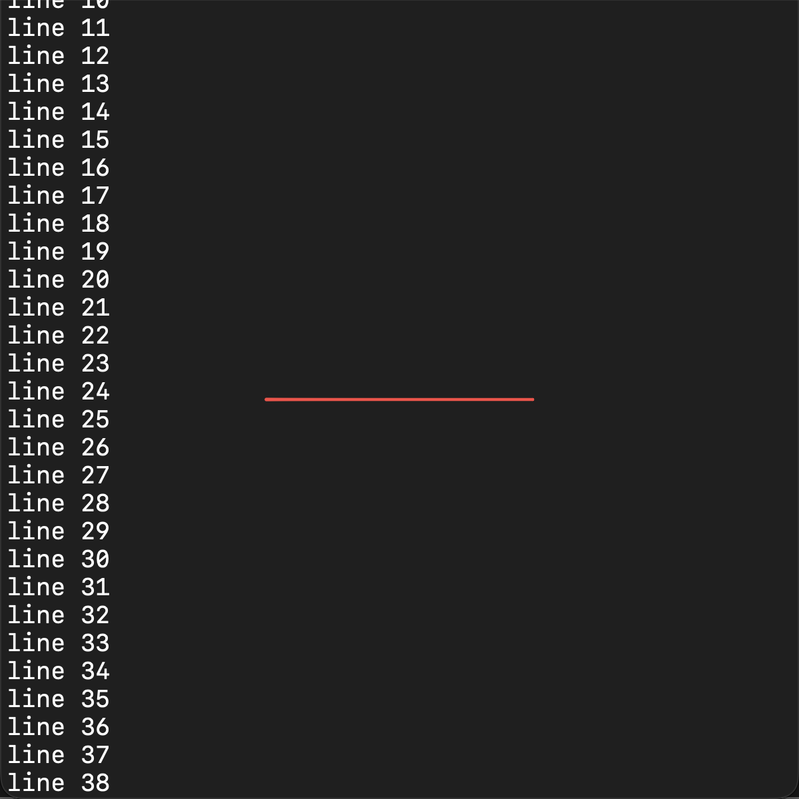
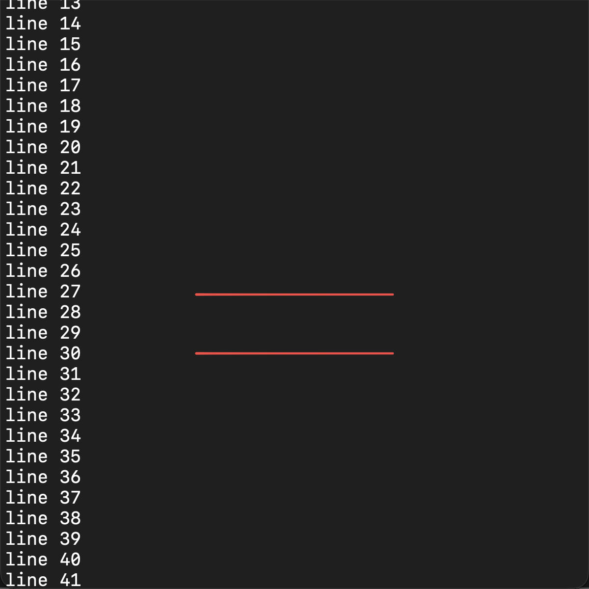

# Scroll through the canvas — run record

This page is the test run for scrolling the app under an open canvas. The ink stays where it was drawn on screen; it does not follow the content.

Run on macOS 27.0.1, Swift 6.3, debug build launched as `Annotated --show` from a shell that holds Accessibility permission. Events were synthetic, posted at `kCGHIDEventTap` by `drive.swift` over a 600×600 test window from `page.swift`, a text view of 400 numbered lines.

## Test cases

| # | Action/input | Expected | Source | Result (measured) | Evidence |
| --- | --- | --- | --- | --- | --- |
| S1 | Draw a stroke, then 10 vertical scrolls of 20 px | The page scrolls 200 pt; the stroke stays put on screen | `OverlayController.filter` | page origin 0 → 200; stroke at the same screen position |   |
| S2 | 10 horizontal scrolls, then 3 vertical scrolls and a drag 30 ms after the last one | The drag draws ink and does not select text in the page | held-click replay in `OverlayController.filter` | second stroke committed; 0 selection changes; page origin at 260 |  [page-output.txt](../artifacts/scroll-through/page-output.txt) |

## What the prototype found

`proto.swift` is the throwaway that settled the design, with one small canvas over one small scroll view.

- Posting a scroll straight to the other app's pid (`CGEvent.postToPid`) reaches it but scrolls nothing: AppKit takes the in-window location from the real cursor, so the hit test misses.
- Setting `ignoresMouseEvents` from inside the tap is too late for the event that triggered it, because that event has already been routed. The setting reaches the window server 5–60 ms later; the delay varied from run to run and no flush shortened it.
- A copy of an event that has already landed on the canvas carries the canvas in private field 51 and goes straight back to it however long it waits. Clearing the public fields 91 and 92 was not enough; clearing 51 made each retry land on the page on its first try.

## Ink following the content, tried and dropped

Moving the ink with the content was built first and removed. Event deltas drift at the end of a page and through a rubber band. Following an accessibility element of the page fixed that in a test page and in Arc, but in real use it still broke, so the ink now stays where it is drawn.

## Not covered

A real trackpad with momentum and a real mouse wheel: each needs a person.
